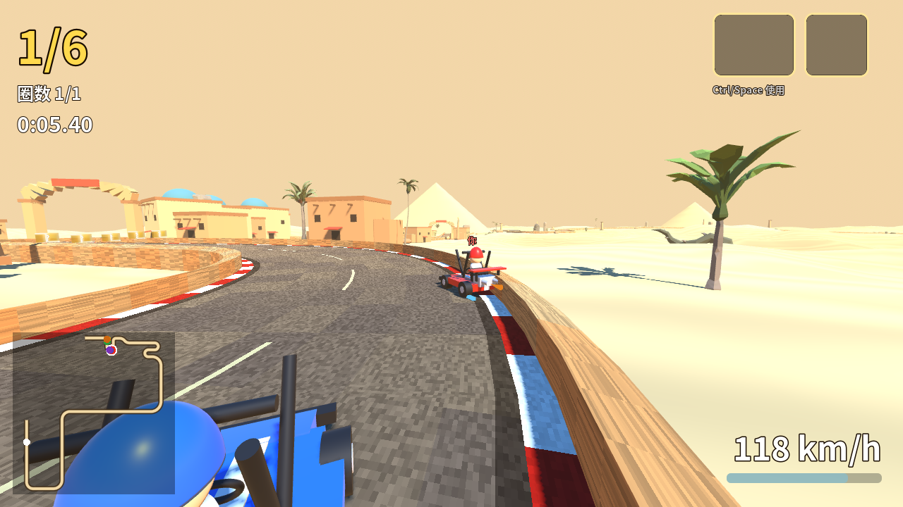

# 时之沙 · 沙漠卡丁车道具赛 (Sands of Time Kart)

**在线试玩 / Play in browser:** https://radaren.github.io/sands-kart-demo/

一个用 **Godot 4.7.2（GDScript）** 制作的 6 人沙漠道具赛 Demo：单程约 2.9 km（风格参考 QQ飞车「时之沙」），规则参考 QQ飞车道具赛。
本仓库基于作者已有的工程（卡丁车物理、赛道数据/生成、道具定义、美术与音效素材），在其架构上补全了 AI、橡皮筋、道具效果、排名、比赛流程、HUD、测试和 Web 发布。



## 操作 Controls

| 按键 | 动作 |
|---|---|
| W / ↑ | 加速（GO 前 0.35 秒内按下 = 起步超级喷，过早会「起步过早」；漂移结束后点按 = 小喷，紧接再点 = 双喷） |
| S / ↓ | 刹车 / 倒车 |
| A D / ← → | 转向 |
| Shift / X | 漂移（X 是备用键，避免连按 Shift 触发 Windows 粘滞键） |
| Space / E / J | 使用道具（2 个道具栏，先用第 1 个）；桌面版另可用 Ctrl。网页版不绑定 Ctrl，因为浏览器里 Ctrl+W 会直接关闭标签页 |
| Q | 向前扔道具（香蕉皮向前抛约 20 m；其他道具与普通使用相同） |
| R | 重生到赛道（3 秒惩罚；仅比赛中可用，2 秒冷却） |
| B | 回看 |
| Esc | 暂停 |

### 加速技巧 Boost tricks

- **落地喷**：跳台飞行约 0.6–1.0 秒；落地瞬间出现白色光圈 + 「叮」声 + 「落地喷! 点按 ↑/W」提示，0.3 秒内松开再按一下 ↑/W，获得 +3 m/s、持续 1.5 秒（落地前 0.1 秒内的点按也算）。
- **空喷**：空中点按 ↑/W，每次腾空只能用一次。
- **起步喷**：倒计时数字变绿（GO 前 0.35 秒）时按下 ↑/W 或在 GO 后 0.1 秒内点按；GO 前 0.35–1.5 秒就按下会「起步过早!」，没有加速。
- **小喷分级**：漂移火花 白（<0.45 s）→ 蓝（≥0.45 s，+7.5 m/s）→ 橙（≥1.1 s，+9）→ 紫（≥1.8 s，+10.5），松开漂移后点按 ↑/W 触发。
- **双喷**：小喷后 0.12–0.6 秒内再点一次；0.15–0.30 秒之间为「完美双喷!」（+10.5 m/s × 1.2 s），太快会「太早!」失败。

道具平衡：闪电 −4 m/s × 2 秒（护盾可挡），后排掉率减半；飞碟 −5 m/s 最长 3 秒，被罩住时持续加速或漂移 0.8 秒可「甩掉飞碟」；导弹沿赛道中线飞行，转向上限 2.2 rad/s，约 1.5 秒到达前出现锁定警告，最后关头急转或加速可以躲开。

## 玩法内容 Features

- **赛道**：小镇 → 跳台 → 峡谷（砂岩峭壁 + U 形弯）→ 沙丘（S 弯、R28 技术弯、发夹弯），约 3.3 km，含 3 个跳台、加速带、道具箱点（1.2 秒刷新）、检查点、终点；路肩外 8–11 m 有一条标识带（三角旗桩、弯道外侧红白警示牌、小镇/峡谷/起终点火把，MultiMesh 绘制）。
- **车辆**：漂移 + 小喷 / 双喷、起步超级喷、空中/落地喷、氮气、加速带；多个加速效果取最大值不叠加。
- **AI**：前视驾驶、走线偏移与内线、自动漂移与小喷、性格（激进/稳健/失误率）、宿敌「紫电」、橡皮筋（10 秒后启用，落后最多 +15%，领先最多 −10%）。
- **道具（8 种）**：氮气、导弹、磁铁、香蕉皮、乌云、护盾、闪电、UFO；按名次分档的掉落权重。
- **比赛逻辑**：曲线进度 + 检查点排名、逆行提示、掉落/卡住自动重生、成绩表（格式 1:23.45）、再来一局 / 返回标题。
- **HUD**：名次、圈数、计时、km/h + 加速条、2 个道具栏、小地图、中央提示。

## 运行 How to run

1. 安装 [Godot 4.7.2-stable](https://godotengine.org/download)（标准版，非 .NET）。
2. 用 Godot 打开本目录的 `project.godot`，按 F5。
   或命令行：`godot --path .`

测试（无界面）：`GODOT=godot bash tools/run_tests.sh`（语法检查 + 单元测试 + 7 个随机种子的整场比赛），或：

```bash
godot --headless --path . --import
GODOT=godot bash tools/check_scripts.sh                    # 语法检查
godot --headless --path . --fixed-fps 60 res://tests/test_runner.tscn -- --test --seed=7
```

测试覆盖：倒计时、起步喷窗口、小喷分级/完美双喷、道具平衡、起步喷速度、漂移小喷、拾取/使用道具、排名更新、逆行/重生、完赛与成绩表，结果写入 `tests/test_results.json`。
截图：`xvfb-run godot --path . --rendering-method gl_compatibility --fixed-fps 60 res://tests/screenshot_runner.tscn -- --autopilot`。

## Web 版 Web build

推送到 `main` 后，GitHub Actions（`.github/workflows/pages.yml`）会下载 Godot 4.7.2 和导出模板，导出 Web（Compatibility 渲染器，单线程，不需要 COOP/COEP 头），并发布到 GitHub Pages。
本地导出：`godot --headless --path . --export-release "Web" build/web/index.html`（需要安装 4.7.2 导出模板）。

## 素材说明 Assets

- 仙人掌、棕榈、岩石：作者提供的低多边形模型（`assets/props_raw/`）。
- 泥屋、石柱、拱门、方尖碑、金字塔，以及卡丁车模型：暂用程序生成的替代模型（`scripts/props/procedural_prop.gd`、`scripts/kart_visual.gd`），之后可以直接换成正式模型。
- 背景音乐 `assets/audio/bgm_desert_loop.wav` 是程序生成的临时循环（作者提供的 BGM 文件只是很短的占位片段）。
- 字体：Noto Sans CJK SC Bold 子集（SIL OFL 1.1，见 `assets/fonts/OFL.txt`）。

## 状态 / 路线图 Status & roadmap

- [x] 完整单程比赛流程、6 车 AI、8 种道具、HUD、结算（冲线大字名次+彩带，6 秒后出成绩表，含本局数据；按钮 1 秒后才可点，防止误按）
- [x] 无界面自动测试 + 截图
- [x] Web 版自动部署（GitHub Pages）
- [ ] 正式卡丁车与建筑模型、正式 BGM
- [ ] 手柄 / 触屏操作、更多赛道、多圈模式

---

### English (short)

A 6-kart desert item-race demo in Godot 4.7.2 (GDScript), inspired by the "Sands of Time" track from QQ Speed. It is built on the author's existing project (kart physics, track data and builder, item definitions, assets). On top of that this repo adds AI with rubber-banding, item effects, ranking, race flow, the HUD, headless tests and an auto-deployed web build.
Controls: W/S throttle and brake, A/D steer, Shift/X drift, Space/E/J item (desktop also Ctrl; never Ctrl on web because Ctrl+W closes the tab), R respawn, Esc pause.
Run it by opening `project.godot` in Godot 4.7.2, or play it in the browser at the link above. Some props, the kart model and the BGM are procedural placeholders.

License: MIT (code). Bundled font: SIL OFL 1.1.
